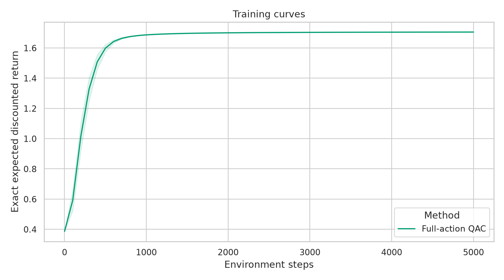
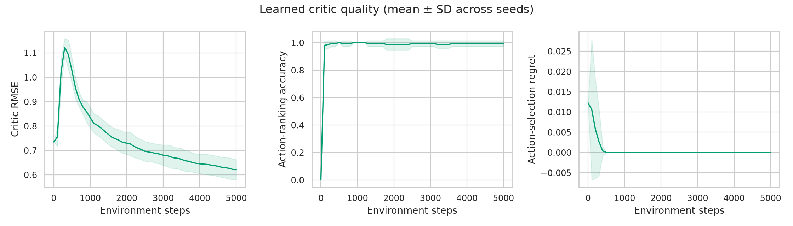
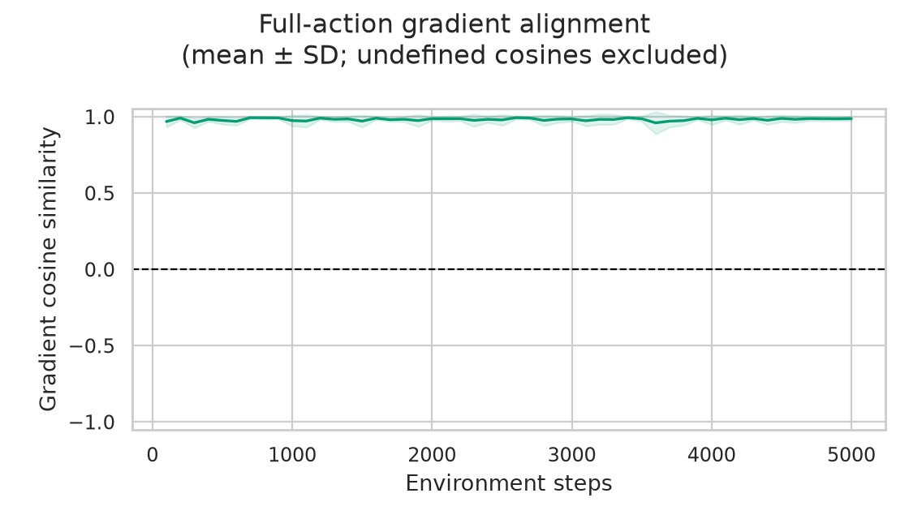
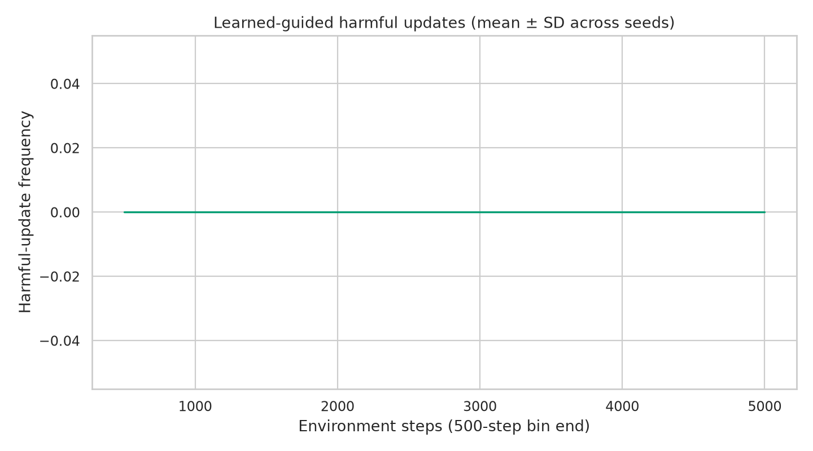
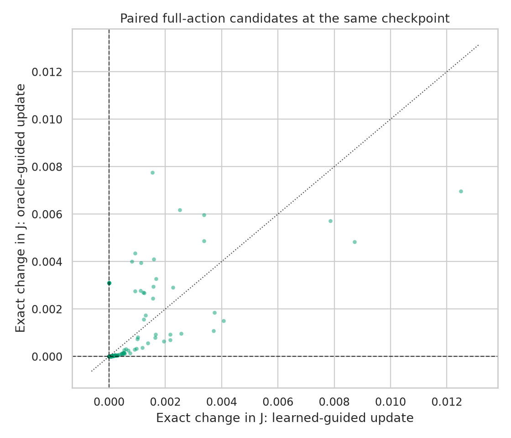
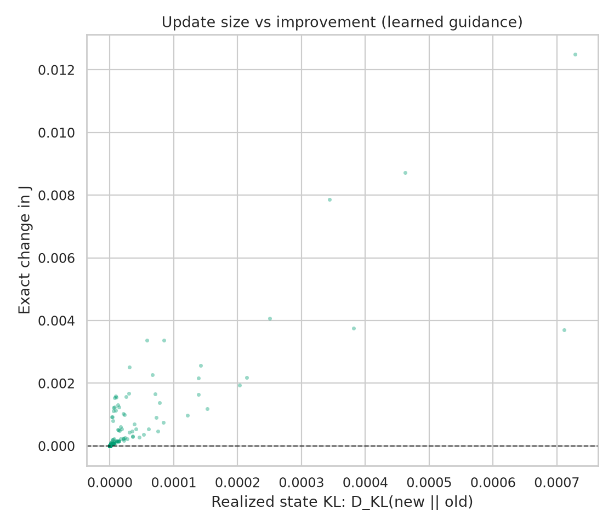
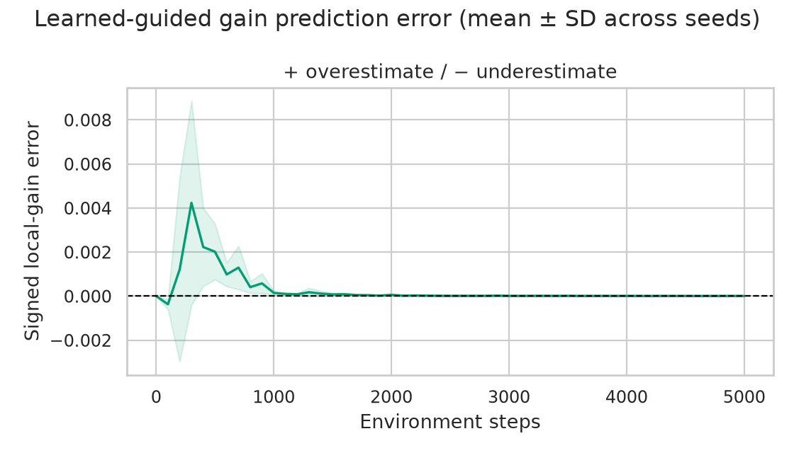
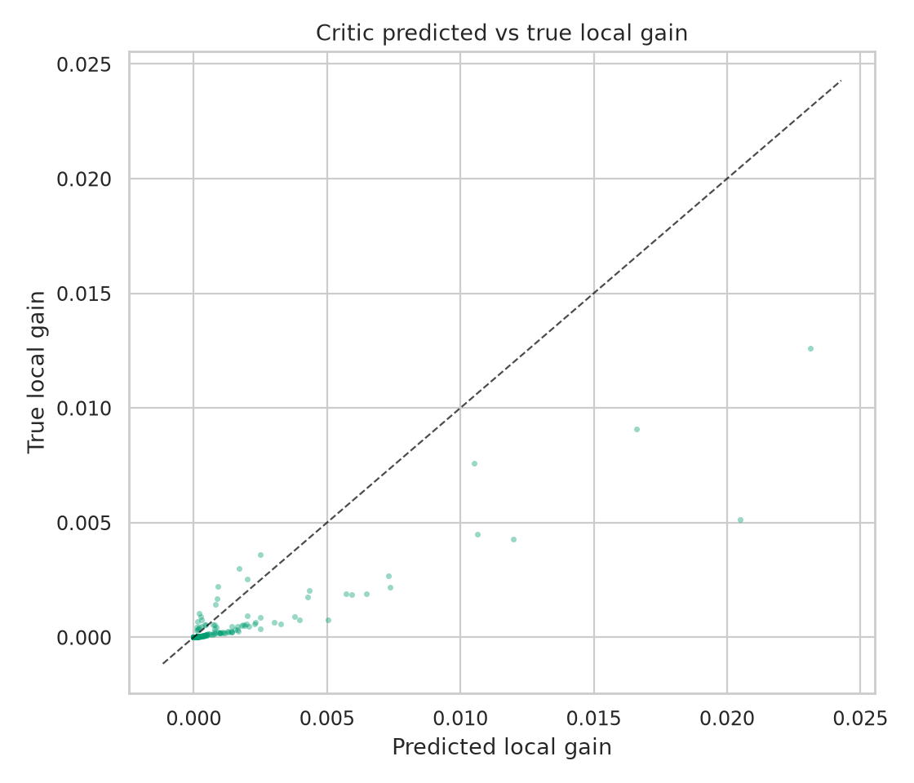

# 001 — QAC Critic Reliability in Simple MDP Environment


## Motivation

Actor–critic reinforcement learning uses learned action-value estimates to guide policy updates. These estimates are noisy,particularly in the early stages of training when experience is limited, and can actually cause policy updates to make the policy worse, in terms of expected return.

Additionally, accurate value estimation and reliable policy improvement are not necessarily equivalent. A critic may exhibit substantial value-prediction error while preserving the relative action preferences needed to improve a policy. Conversely, errors in those preferences may cause the actor to reinforce inferior actions, potentially reducing performance.

If we could somehow quantify and describe the critic conditions which cause destructive policy updates, we might be able to design around these. This experiment investigates the relationship between **critic estimation quality** and the **reliability of critic-guided policy updates**. By reliability, we mean whether the policy update actually improves the policy. We seek to determine which critic characteristics cause destructive policy updates.

To this end, we construct a small, exactly evaluable Markov decision process that provides access to the true action values and expected return of any policy. This makes it possible to distinguish errors in the learned critic from their consequences for policy improvement. This controlled setting isolates the relationship between critic error and policy improvement before introducing additional complexity from function approximation and larger environments.

## Research Question

**How does critic estimation quality relate to the reliability and effectiveness of policy improvements in a simple tabular QAC setting?**

## Methodology

### Overview

1. **Define the environment.** Construct a small, finite MDP in which exact action values and policy performance can be calculated.

2. **Train an actor–critic agent.** Train a tabular QAC agent for 5,000 environment transitions across 10 random seeds.

3. **Evaluate the critic.** At regular checkpoints, compare the learned action-value estimates against exact values to measure critic accuracy, action ranking, and gradient alignment.

4. **Construct counterfactual policy updates.** At each checkpoint, generate two hypothetical actor updates from the same policy: one guided by the learned critic and another by exact action values.

5. **Evaluate policy improvements.** Calculate the true performance change produced by each update, alongside predicted improvement and policy-update magnitude.

6. **Analyze the relationships.** Examine how critic estimation errors relate to update reliability, prediction accuracy, and performance differences between learned and exact critic guidance.

### 1. Experimental Environment

The experiment uses `branching_mdp_v1`, a handcrafted finite discounted MDP with stochastic transitions and delayed rewards.

| Property | Configuration |
|---|---|
| Environment | `branching_mdp_v1` |
| Decision states | 5 |
| Actions per state | 3 |
| Terminal states | 1 absorbing state |
| Discount factor | 0.95 |
| Initial state | State 0 |
| Reward structure | Transition costs and delayed terminal reward |
| Reference evaluation | Exact Bellman solution |

The finite state space permits exact computation of $Q^\pi(s,a)$ and expected discounted return $J(\pi)$ for every checkpoint policy.

### 2. Learning Algorithm

Training uses a tabular **full-action Q Actor–Critic (QAC)** learner.

The critic estimates action values using on-policy one-step Expected SARSA. The actor performs gradient ascent on the expected action value under the current policy:

$$
\theta_{s,a} \leftarrow \theta_{s,a} +
\alpha \pi(a|s)
\left[
\hat Q(s,a) -
\sum_b \pi(b|s)\hat Q(s,b)
\right].
$$

| Parameter | Configuration |
|---|---|
| Training method | `qac_full` |
| Policy representation | Tabular softmax logits |
| Critic representation | Tabular action values |
| Critic update | One-step Expected SARSA |
| Actor learning rate | 0.20 |
| Critic learning rate | 0.12 |
| Initialization | Zero actor logits and critic values |
| Training duration | 5,000 environment transitions per seed |
| Checkpoint interval | 100 transitions |
| Random seeds | 0–9 |


### 3. Counterfactual Policy Updates

At each checkpoint, the current policy and learned critic are frozen.

Two hypothetical full-action QAC updates are constructed at the checkpoint's next decision state.

| Condition | Learned guidance | Oracle guidance |
|---|---|---|
| Starting policy | Current checkpoint policy | Same |
| Update operator | Full-action QAC | Full-action QAC |
| Critic guidance | **Learned $\hat Q$** | **Exact $Q^\pi$** |
| Actor learning rate | 0.20 | 0.20 |
| Updated states | One | Same |

Both candidates are evaluated against the same starting policy. This paired comparison isolates the difference between learned and exact critic guidance at a fixed checkpoint.

### 4. Measurements

Three categories of measurements characterize critic quality and policy-improvement reliability.

**Critic quality**

| Metric | Description |
|---|---|
| RMSE | Error between learned and exact action values |
| Action-ranking accuracy | Fraction of eligible action pairs correctly ordered by the learned critic |
| Action-selection regret | True value lost by selecting the learned critic's preferred action rather than the optimal action |
| Gradient alignment | Cosine between learned-critic and exact-critic full-action logit gradients at the evaluated state, plus both norms |

**Candidate update quality**

| Metric | Description |
|---|---|
| Predicted local gain | Estimated improvement under the guidance critic |
| True local gain | Local improvement evaluated using exact action values |
| Actual performance gain | Change in exact expected return, $J(\pi')-J(\pi)$ |
| Realized state KL | $D_{\mathrm{KL}}(\pi'(\cdot\mid s)\Vert\pi(\cdot\mid s))$ |
| Signed / absolute prediction error | Predicted minus true local gain, and its absolute value, for learned-guided updates |
| Update outcome | Beneficial, harmful, or effectively zero global gain using absolute tolerance $10^{-12}$ |

**Training performance**

| Metric | Description |
|---|---|
| Expected return | Exact discounted return of the trained policy at each checkpoint |
| Training progress | Number of completed environment transitions |
| Optimal expected return | Exact optimal MDP return $J^*$ as a convergence reference |

### 5. Analysis

The analysis compares learned-guided and oracle-guided candidate updates at matched checkpoints.

| Analysis | Purpose |
|---|---|
| Predicted versus true local gain | Characterize the accuracy of the learned critic's improvement predictions |
| Update outcome counts and frequencies | Quantify beneficial, harmful, and effectively zero learned-guided updates |
| Paired learned/oracle gain and KL | Compare improvement and magnitude at checkpoints and within each seed |
| Critic quality versus update error | Examine relationships between critic estimation quality and improvement reliability |
| Critic quality and gradient alignment over training | Track value error, action preferences, and local gradient direction |
| Signed and absolute prediction errors over training | Distinguish overestimation from underestimation and error magnitude |
| Expected return over training | Contextualize convergence relative to $J^*$ |


## Results

### Summary
| Metric | Result |
|---|---|
| Final expected return | 1.7053 ± 0.0003 |
| Mean gradient cosine similarity | 0.9817 |
| Beneficial learned-guided updates | 500/510 (98.04%) |
| Harmful learned-guided updates | 0/510 (0%) |
| Mean learned-guided performance gain | 0.000202 |
| Mean oracle-guided performance gain | 0.000258 |

In this simple MDP environment, the QAC learner converged to the optimal policy well within the 5000 environment interaction budget. The mean gradient cosine similarity between the learner and the oracle critics was 0.9817, indicating strong gradient alignment. All of the counterfactual critic-guided policy updates showed either improvement or no effect for the policy in this setting. We observe the mean oracle guided policy performance gain across all counterfactual updates is approximately 27.9% greater than the critic guided policy updates.

### Agent performance



The agent's policy approaches optimal expected return across all ten seeds.

### Critic Estimation Quality






We observe that although the learned critic retains a high RMSE, it almost perfectly follows the oracle's action-ranking, and gradient alignment between the oracle and learner critic is close to its maximal value.


### Policy Improvement Reliability



All measured counterfactual policy updates guided by the learned critic were beneficial or neutral in this environment.



Oracle-guided updates tend to produce greater policy improvement than learned-critic-guided updates when evaluated from the same checkpoints. The performance gap persists across most random seeds, although the learned critic sometimes performs better.



Here, on the left, we measured the expected change in return as a function of how much the policy changed as a result of a counterfactual policy update for both learned and oracle guided policies in terms of the KL divergence between the old and the new policy. The results show us that, in general, the oracle guided policy updates changed the policy less than the learner, but led to larger increases in the policies' expected return.

On the right, we summarize average KL divergence changes by oracle and learned critic across the ten seeds. The data shows that the learned critic produces larger average changes to the policy than the oracle in the majority of runs.

### Policy Improvement Prediction Accuracy




We measured the difference between what the critic predicts an update will accomplish and what that update actually accomplishes locally.




## Interpretation

The results suggest that accurate action-value estimation is not strictly necessary for reliable policy improvement in the examined MDP. Although the learned critic retained substantial estimation error throughout training, its action rankings closely matched those of the oracle, and its policy gradients were strongly aligned with the gradients obtained from exact action values. The observed combination of nontrivial critic RMSE, high ranking accuracy, and strong gradient alignment is consistent with the hypothesis that **the structure of critic error matters more for policy improvement than its absolute magnitude alone**. However, this experiment does not establish a causal relationship between these quantities.

Overall, this experiment establishes a baseline in which imperfect critic estimates still support reliable policy improvement, but produce less effective updates than exact critic guidance. The absence of harmful updates prevents us from identifying the specific critic errors responsible for destructive policy changes. Further experiments are therefore needed to determine how errors in action ranking, gradient direction, and gradient magnitude independently affect policy improvement.


## Limitations

This experiment examines one tabular learner operating on one handcrafted MDP. Its conclusions do not directly generalize to neural function approximation or larger environments.

## Reproduction

### 1. Run the experiment

```bash
uv run --locked policy-lab \
  --methods qac_full \
  --steps 5000 \
  --eval-every 100 \
  --actor-lr 0.20 \
  --critic-lr 0.12 \
  --seeds 0 1 2 3 4 5 6 7 8 9 \
  --out-dir experiments/001-critic-reliability/data
git rev-parse HEAD > experiments/001-critic-reliability/data/source_revision.txt
```
### 2. Generate figures and statistical summaries

```bash
uv run --locked policy-lab-plot \
  experiments/001-critic-reliability/data \
  --out-dir experiments/001-critic-reliability/analysis
```
