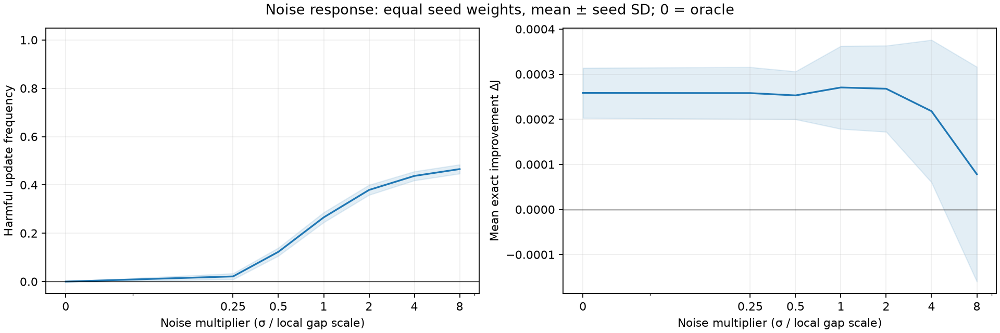
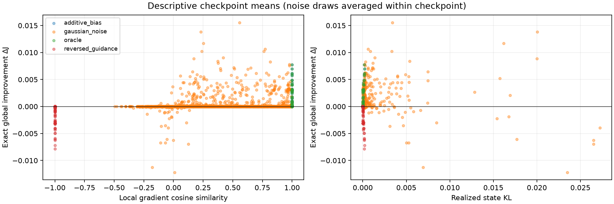

# 002 — Controlled Critic Error

How wrong can a critic be before its advice causes a harmful policy update?
Experiment 001 observed useful updates despite substantial value error. This
experiment separates errors in absolute scores from errors that change the
actor's advice.

## The experiment in plain language

1. Train the same tabular actor–critic as Experiment 001.
2. Pause at a checkpoint and calculate the true action values for that policy.
3. Give the actor exact, biased, noisy, or reversed versions of those values.
4. Try one update with each version, always starting from the same checkpoint.
5. Calculate whether each candidate improves expected return, then discard it.

The learner never receives exact values or synthetic guidance. These are
uncommitted diagnostic updates. The experiment measures the reliability of
individual updates; it does not train separate agents under each noise level.

The actor compares each action's score with the policy-weighted average score.
Adding 10 to every action raises both by 10 and cancels out. For example,
`[1, 2, 3]` and `[11, 12, 13]` produce the same update even though their absolute
values differ greatly. Random noise can change those comparisons; negation
reverses the local update direction.

## Protocol

| Setting | Value |
|---|---|
| Environment | `branching_mdp_v1`: five decision states, three actions, one absorbing terminal state |
| Discount / initial state | 0.95 / state 0 |
| Learner | Tabular softmax full-action QAC with a one-step Expected SARSA critic |
| Actor / critic learning rate | 0.20 / 0.12 |
| Initialization | Zero logits and critic values |
| Training | 5,000 transitions for each seed 0–9 |
| Checkpoints | Step 0 and every 100 completed transitions: 510 total |
| Updated state | Next decision state at the checkpoint, including reset after termination |

Checkpoints follow the specified learning updates; step 0 precedes learning.
Every candidate changes only the same state's logits, using the existing update
without KL backtracking:

$$
\theta'_{s,a}=\theta_{s,a}+0.20\,\pi(a\mid s)
\left[\widetilde Q(s,a)-\sum_b\pi(b\mid s)\widetilde Q(s,b)\right].
$$

Synthetic guidance is constructed around exact $Q^\pi$, replacing the learned
critic for this diagnostic only. It is not noise added to the learned critic.

| Condition | Guidance | Candidates per checkpoint |
|---|---|---:|
| Oracle | $Q^\pi$ | 1 |
| Additive bias | $Q^\pi+10$ | 1 |
| Reversed guidance | $-Q^\pi$ | 1 |
| Gaussian noise | $Q^\pi(s,a)+m g_s Z_{s,a}$ | 20 draws at each of six multipliers |

Here $Z_{s,a}$ are independent standard normals and
$m\in\{0.25,0.5,1,2,4,8\}$. The noise scale $g_s$ is the RMS of the three
pairwise action-value differences at state $s$, floored at $10^{-6}$.
A multiplier of 1 therefore means noise on the scale of typical action-value
differences. The grid is fixed independently of observed gains.

This gives **123 candidates per checkpoint and 62,730 total**. The oracle is
also the zero-noise reference in the figure; no duplicate zero-noise or zero-bias
candidates are generated. Bias invariance at 0, 1, and 10 remains directly tested.

## Measurements and summaries

The two primary measurements are:

- **Harmful frequency:** fraction of candidates with exact expected-return change
  $\Delta J=J(\pi')-J(\pi)<-10^{-12}$.
- **Mean gain:** mean exact $\Delta J$. This distinguishes average performance
  from how often an individual update hurts.

Supporting diagnostics describe the three actions at the updated state:
local critic RMSE, local pairwise ranking accuracy, gradient cosine and both
norms, realized $D_{KL}(\pi'\Vert\pi)$, exact local gain, and the paired
oracle-minus-candidate global gain. Positive paired differences favor the oracle.
The oracle is a reference, not an assumed best finite-step candidate.

Local gain is $\sum_a[\pi'(a\mid s)-\pi(a\mid s)]Q^\pi(s,a)$. Global gain
also accounts for visitation: it equals local gain times the new policy's
unnormalized discounted occupancy of the updated state. Only that state's
critic row affects this candidate, so EXP002 no longer reports global
synthetic-critic metrics. Training checkpoint diagnostics retain their EXP001
meaning.

Average draws within each checkpoint, then checkpoints within each seed, then
report equally weighted seed means and sample SD across seeds. Checkpoints and
noise draws are not independent training runs. Harmful frequency averages the
individual harmful indicators, not the sign of mean gain. Initialization has
the same checkpoint weight as later measurements. Beneficial, harmful, and
effectively zero counts retain actual candidate totals.

Ranking excludes true pair gaps at or below $10^{-6}$; predicted ties are
incorrect. No eligible pairs gives NaN. Gradient cosine is NaN if either norm
is at most $10^{-12}$. Means exclude undefined values and retain defined counts
and frequencies. Across-seed summaries include each metric's contributing-seed
count. A single-seed SD is NaN in tables and has zero-width figure bands.

## Results

The full rerun completed using seeds 0–9 and noise root 0: **50,000 training
transitions, 510 frozen checkpoints, and 62,730 candidate updates**.

- Run ID: `36cf1d33e55806bd`.
- Source revision: `5d5abb2e7956383322a4427fde9302fafacd45bc` (clean checkout at execution).
- Python / NumPy: 3.11.14 / 2.4.6.
- Analysis validated the complete grid and pairings, producing 4,590 checkpoint
  summary rows, 90 seed rows, and nine across-seed rows. All gradient cosines
  are defined; every across-seed metric has ten contributing seeds.

| Condition | Candidates | Harmful | Harmful frequency (%) | Mean ΔJ |
|---|---:|---:|---:|---:|
| Oracle / zero noise | 510 | 0 | 0.00 ± 0.00 | 2.58301e-04 ± 5.55524e-05 |
| Additive bias +10 | 510 | 0 | 0.00 ± 0.00 | 2.58301e-04 ± 5.55524e-05 |
| Reversed guidance | 510 | 510 | 100.00 ± 0.00 | -2.61842e-04 ± 5.65467e-05 |
| Gaussian noise, m = 0.25 | 10,200 | 216 | 2.12 ± 1.24 | 2.57994e-04 ± 5.74965e-05 |
| Gaussian noise, m = 0.5 | 10,200 | 1,255 | 12.30 ± 1.67 | 2.52866e-04 ± 5.30511e-05 |
| Gaussian noise, m = 1 | 10,200 | 2,709 | 26.56 ± 2.06 | 2.70457e-04 ± 9.19004e-05 |
| Gaussian noise, m = 2 | 10,200 | 3,867 | 37.91 ± 2.07 | 2.67687e-04 ± 9.55133e-05 |
| Gaussian noise, m = 4 | 10,200 | 4,459 | 43.72 ± 1.86 | 2.17909e-04 ± 1.57951e-04 |
| Gaussian noise, m = 8 | 10,200 | 4,748 | 46.55 ± 1.87 | 7.81098e-05 ± 2.38030e-04 |

Every candidate not counted as harmful was beneficial; none were effectively
zero. Each ± is sample SD across the ten seed means, not a confidence interval.
Frequency SDs are in percentage points. Full precision and supporting local
measurements remain in [summary.csv](analysis/summary.csv) and the raw records.



The zero-noise point reuses the oracle baseline. Bands show mean ± seed SD;
individual outcomes determine harmful frequency even when mean gain is positive.



Each scatter point is a checkpoint/condition/magnitude mean, averaging the 20
noise draws where applicable. These descriptive means are not independent-run
observations or inferential correlation tests; raw draws retain relationships
that averaging can obscure.

### Verification against the earlier run

All 510 frozen policies, learned critics, checkpoint states, and training
measurements match the earlier working-tree run `4f40ac4c886bef49` exactly.
All 62,730 retained candidate rows match its shared measurements exactly,
including noise seeds, local diagnostics, gains, outcomes, and oracle pairing.
The reduced grid removes 11,220 redundant baseline/control rows. The earlier
README and outputs were preserved locally under ignored
`artifacts/002-controlled-critic-error/before-simplification/`.

The full test suite passed (72 tests), as did Ruff. Tests directly check bias
cancellation, reversed gradients, local/global gain consistency, undefined
metrics, candidate and training isolation, hierarchical weighting, grid/pairing
validation, snapshot reconstruction, and figure generation.

## Interpretation

Reserved for manual scientific interpretation.

## Limits

This is one small handcrafted MDP with tabular policies and synthetic critic
errors. Single-step results do not establish long-term learning performance or
generalization to larger environments and learned function approximators.
The updated state follows the training trajectory rather than uniform sampling.
Twenty noise draws give checkpoint frequencies in increments of 0.05; ten
training seeds limit precision. Equal actor learning rates do not match realized
KL, so noise changes both direction and update size. Gradient alignment alone
does not determine finite-step gain. Near tied values, the gap floor supplies an
absolute noise scale rather than a meaningful relative ratio.

## Reproduce and inspect

From the repository root:

```bash
uv sync --locked --python 3.11 --extra dev --extra analysis
uv run --locked python -m policy_improvement_lab.controlled_error
uv run --locked python -m policy_improvement_lab.controlled_error_plot \
  experiments/002-controlled-critic-error/data \
  --out-dir experiments/002-controlled-critic-error/analysis
uv run --locked pytest -q
uv run --locked ruff check .
```

The runner defaults to the full protocol above and noise root 0. For a smoke
run, use `--steps 10 --eval-every 10 --seeds 0 1` and an output directory under
ignored `artifacts/`. This gives four checkpoints and 492 candidates. Analysis
is offline and never invokes learning. Use fresh output directories for distinct
runs; rerunning replaces files with the same names.

| Output | Contents |
|---|---|
| [data/config.json](data/config.json) | Run configuration, run ID, Git revision, dirty flag, source hashes, Python/NumPy versions |
| [data/checkpoints.csv](data/checkpoints.csv) | Training return, learned-critic diagnostics, and checkpoint identity |
| [data/frozen_checkpoints.npz](data/frozen_checkpoints.npz) | Aligned seed, step, state, logits, learned critic, and run ID arrays |
| [data/counterfactual_updates.csv](data/counterfactual_updates.csv) | Every candidate, local diagnostics, outcomes, pairing keys, and noise seed |
| [analysis/checkpoint_summary.csv](analysis/checkpoint_summary.csv) | Draw means and counts per checkpoint/condition/magnitude |
| [analysis/seed_summary.csv](analysis/seed_summary.csv) | Checkpoint means and counts within each seed |
| [analysis/summary.csv](analysis/summary.csv) | Across-seed means, sample SDs, and contributing-seed counts |

The analysis validates the complete configured grid, unique candidate keys,
checkpoint returns, and paired oracle differences before aggregation. Pairing
uses `(run_id, seed, step, state)`; runs are never combined. Training step remains
in raw and checkpoint tables for further inspection; separate stage summaries
are no longer generated.

Noise still uses the original independent `(5, 3)` table draws and leaves the
terminal state unchanged, preserving the retained comparisons with the earlier
protocol. Only the updated row enters the actor update and local diagnostics.
Each sample has a deterministic seed keyed by training seed, checkpoint step,
multiplier, replicate, and noise root; see
[`noise_seed`](../../src/policy_improvement_lab/controlled_error.py). Noise does
not consume training randomness. The seed is stored as hexadecimal text to
avoid CSV integer precision loss. Deterministic controls use replicate −1 and
an empty noise seed. Load snapshots with `numpy.load`, recompute exact values,
and reconstruct candidates with the saved configuration and keys.

The run ID hashes configuration and source metadata except the dirty flag;
`source_revision.txt` also records the Git revision. Frozen snapshots and source
hashes identify runs made from an uncommitted checkout.
